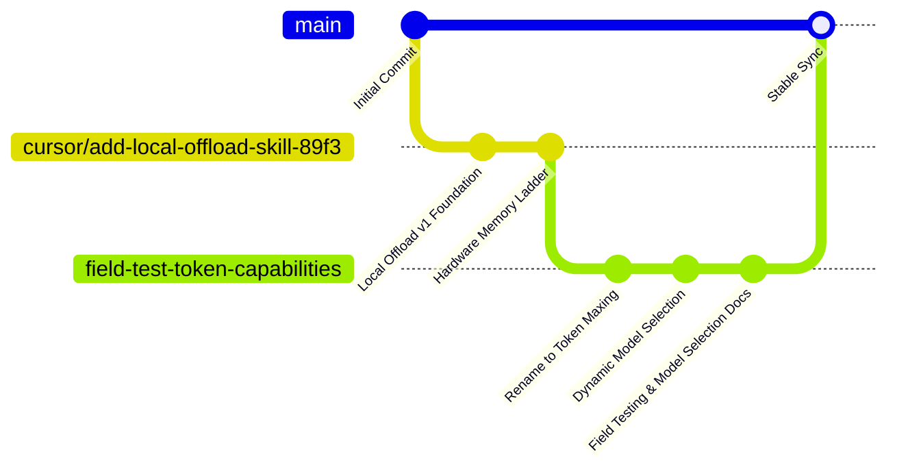
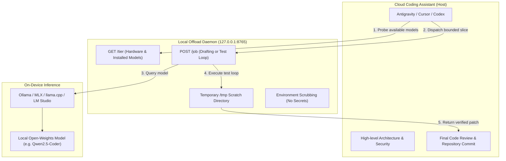

# GrokProjects

An open hub of modular skills, runbooks, and token optimization tools for AI coding assistants (**Google Antigravity**, **Cursor**, and **OpenAI Codex**).

This repository houses multiple independent skills and experimental development tracks. Each project is designed to give AI assistants bounded, deterministic capabilities while preserving user privacy and eliminating paid cloud token waste.

---

## Skills & Projects Catalog

| Project | Primary Directory | Core Capability | Target Backends | Status |
| :--- | :--- | :--- | :--- | :---: |
| **Token Maxing** | [`local-offload/`](https://github.com/Diebeste/GrokProjects/tree/field-test-token-capabilities/local-offload) | Dynamic model-routed local offloading with model capability guards and diagnostics. | Ollama, LM Studio, llama.cpp, MLX | **Active / Recommended** |
| **Local Offload Engine** | [`local-offload/`](https://github.com/Diebeste/GrokProjects/tree/cursor/add-local-offload-skill-89f3/local-offload) | Zero-dependency loopback daemon with hardware-probed memory ladder and isolated test loop. | Ollama, MLX | **Stable Foundation** |
| *Upcoming Skills* | `skills/` | Specialized reverse-engineering parsers, security scanners, and test scaffolding tools. | Local CLI / Python | *In Development* |

---

## Branch Matrix & Features

This repository utilizes focused branches for specialized capabilities and development tracks:



### 1. `field-test-token-capabilities` (Cutting-Edge / Active)
* **Status**: **Recommended for development & testing**
* **Project**: **Token Maxing (v2)**
* **Unique Capabilities**:
  * **Dynamic Model Routing**: `GET /tier` dynamically enumerates all installed local models in `modelOptions` with their supported parameter classes (`7B`, `14B`, `32B`) and slice limits.
  * **Custom Target Dispatch**: The host agent can dispatch to any installed model by specifying `"model": "<name>"` in `POST /job`.
  * **Capability-Aware Prompting**: Guides agents to inspect `ollama show <model>` to detect `thinking` and `tools` capabilities prior to offloading.
  * **Empirical Field Test Suite**: Includes [Field Test Learnings](https://github.com/Diebeste/GrokProjects/blob/field-test-token-capabilities/local-offload/docs/field-test-learnings.md) detailing real-world benchmarks, token starvation behavior in reasoning models, and GGUF drafter compatibility.

### 2. `cursor/add-local-offload-skill-89f3` (Foundation)
* **Status**: **Base Implementation**
* **Project**: **Local Offload (v1)**
* **Unique Capabilities**:
  * **Pure Zero-Dependency Runtime**: Daemon (`server.py`) and installer (`install.py`) built exclusively on the Python standard library.
  * **Hardware Memory Ladder**: Automatic RAM and discrete GPU VRAM detection (`nvidia-smi`, `sysctl`, AMD sysfs, Windows CIM) to automatically pin comfortable model sizes.
  * **Sandboxed Self-Healing Test Loop**: Copies target files into `/tmp` scratch storage, runs allow-listed test runners (`pytest`, `unittest`, `npm test`, `go test`), feeds tracebacks back to the model, and retries up to 5 times.
  * **Absolute Local Isolation**: Hard assertions refusing external network binding (binds only to `127.0.0.1`), strips environment variables during test runs, and blocks secret files (`.env`, `*.pem`, `id_rsa*`).

### 3. `main` (Stable Hub)
* **Status**: **Production Landing Page**
* Reflects stabilized skills, shared documentation, and project indexes.

---

## Architecture: The Host-Worker Pattern

All skills in this repository adhere to a strict **"Host-as-Architect, Local-Model-as-Worker"** design:



---

## Quick Start: Installing a Skill

Install directly from git into your local machine and AI agents:

```bash
# Clone the repository
git clone https://github.com/Diebeste/GrokProjects.git
cd GrokProjects

# Switch to the desired capability branch
git checkout field-test-token-capabilities

# Run the installer for your desired skill
cd local-offload
python3 install.py --path .
```

### Automatic Agent Registration
The installer automatically places the skill runbooks into your configured assistants:
* **Google Antigravity**: Configured globally in `~/.gemini/config/skills/token-maxing/SKILL.md` or in workspace `.agents/skills/`.
* **Cursor**: Registered at `~/.cursor/skills/token-maxing/SKILL.md`.
* **Codex**: Registered at `~/.codex/skills/token-maxing/SKILL.md`.

---

## Model Selection Guidelines

Based on empirical field testing ([detailed report](https://github.com/Diebeste/GrokProjects/blob/field-test-token-capabilities/local-offload/docs/field-test-learnings.md)):

* ⭐️ **Recommended Workhorse**: **`qwen2.5-coder:14b`** or **`qwen2.5-coder:7b`**
  * *Why*: Purpose-built for code generation without internal thinking loops. Generates clean, fence-free patches in under 3 seconds per iteration.
* ⚠️ **Avoid Thinking Models for Fast Loops**: Models with native thinking enabled (e.g. `qwen3-vl:8b`, `deepseek-r1`) consume 1,000–2,000+ tokens strictly on internal reasoning. In tight token envelopes (1,024–2,048 tokens), this causes token exhaustion and empty generation errors.
* ⚠️ **Avoid Speculative Drafter GGUFs**: Repositories containing only speculative drafters (e.g. `dflash`) lack base transformer layers and fail to initialize in Ollama without a primary target context (`ctx_other`).

---

## Adding New Skills to GrokProjects

As this repository expands with new developer capabilities:

1. **Folder Convention**: Create each new skill in its own self-contained root subdirectory (e.g., `skills/<skill-name>/` or `<project-name>/`).
2. **Standard File Structure**:
   ```
   <skill-name>/
   ├── SKILL.md          # Agent prompt and progressive disclosure instructions
   ├── README.md         # Developer documentation and install guide
   ├── install.py        # Automated multi-agent installer
   └── ...               # Runtime scripts or tools
   ```
3. **Branching Strategy**: Use feature branches (e.g., `feature/<skill-name>`) for active development and pull requests into `main` once tested.

---

## License

All projects in this repository are distributed under the [MIT License](LICENSE) unless specified otherwise within an individual project subdirectory.
